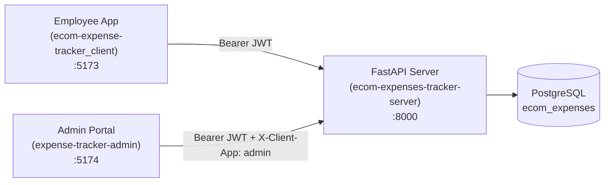

# e-COM Expense Tracker (Unified Repository)

Unified monorepo for the **e-COM Services Expense Tracker** platform. This system replaces the manual Excel spreadsheet workflow (*"Expenditure Tracker"*) with a full-stack web platform for recording company expenditures, managing petty cash, cataloguing items and categories, and generating monthly/annual financial reports.

---

## 📁 Repository Structure

This repository houses all three core entities of the platform:

| Directory | Entity | Tech Stack | Default Port | Description |
| :--- | :--- | :--- | :--- | :--- |
| [`./ecom-expense-tracker_client`](./ecom-expense-tracker_client) | **Employee Web App** | React 19, TypeScript, Vite, Tailwind CSS v4 | `5173` | Staff portal for recording individual/shared expenses, viewing petty cash, and exporting reports. |
| [`./expense-tracker-admin`](./expense-tracker-admin) | **Administrator Web App** | React 19, TypeScript, Vite, Tailwind CSS v4, Radix UI | `5174` | Admin portal for user management, category/item catalogs, petty cash ledger, `.xlsx` imports, and global settings. |
| [`./ecom-expenses-tracker-server`](./ecom-expenses-tracker-server) | **Backend API Server** | FastAPI, SQLAlchemy 2, Alembic, PostgreSQL | `8000` | Shared REST API providing JWT authentication, role-based access control, integer pesewa money math, and PDF/Excel report exports. |

---

## 🏗 System Architecture



- **Strict Role Separation**: Employees sign in via the Employee App (`ecom-expense-tracker_client`), while administrators use the standalone Admin Portal (`expense-tracker-admin`). Attempting to sign in to the wrong portal returns a `403` response with a direct link to the appropriate application.
- **Exact Currency Arithmetic**: All monetary values are stored and calculated in integer pesewas (`1 GHS = 100 pesewas`) to prevent floating-point rounding errors, and formatted as `GH₵`.
- **Dual-Mode Frontend Operation**: Both frontend apps can connect to the live FastAPI backend (`VITE_USE_MOCKS=false`) or run standalone in the browser using Mock Service Worker (`VITE_USE_MOCKS=true`).

---

## 🚀 Quick Start (Full Stack)

### 1. Start the Backend Server (`ecom-expenses-tracker-server`)

Requires **Python 3.10+** and **PostgreSQL**.

```powershell
cd ecom-expenses-tracker-server
python -m venv .venv
.\.venv\Scripts\Activate.ps1
pip install -r requirements.txt
copy .env.example .env
```

Configure `DATABASE_URL` and `SECRET_KEY` in `ecom-expenses-tracker-server/.env`, then run migrations, seed initial data, and start the server:

```powershell
alembic upgrade head
python -m app.seed
uvicorn app.main:app --reload --port 8000
```

- **Interactive Swagger UI**: `http://localhost:8000/docs`
- **Health Check**: `http://localhost:8000/api/health`

---

### 2. Start the Employee Client (`ecom-expense-tracker_client`)

Requires **Node.js 18+**.

```powershell
cd ecom-expense-tracker_client
copy .env.example .env
npm install
npm run dev
```

Runs at `http://localhost:5173`.

---

### 3. Start the Administrator Portal (`expense-tracker-admin`)

Requires **Node.js 18+**.

```powershell
cd expense-tracker-admin
copy .env.example .env
npm install
npm run dev
```

Runs at `http://localhost:5174`.

---

## 🔐 Default Demo Credentials

| Role | Email | Password | Portal |
| :--- | :--- | :--- | :--- |
| **Administrator** | `admin@ecom.com` (or `admin@example.com`) | `password123` (or `ChangeMe123!`) | Admin Portal (`:5174`) |
| **Employee** | `employee@ecom.com` | `password123` | Employee App (`:5173`) |

---

## 📖 Component Documentation

For detailed setup instructions, environment variables, routes, and testing guides for each service, see its dedicated README:

- [Employee Client Documentation (`ecom-expense-tracker_client/README.md`)](./ecom-expense-tracker_client/README.md)
- [Administrator Portal Documentation (`expense-tracker-admin/README.md`)](./expense-tracker-admin/README.md)
- [Backend Server Documentation (`ecom-expenses-tracker-server/README.md`)](./ecom-expenses-tracker-server/README.md)

---

## 📄 License

Licensed under the terms specified in [LICENSE](./LICENSE).
